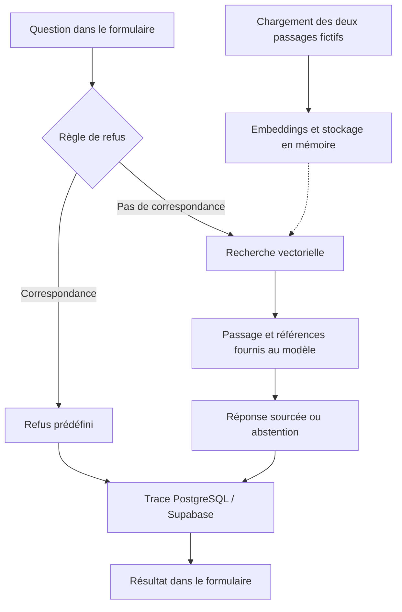
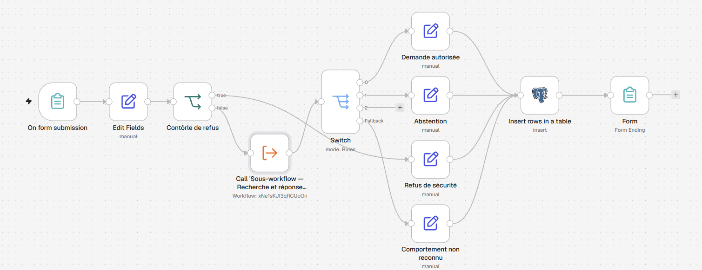
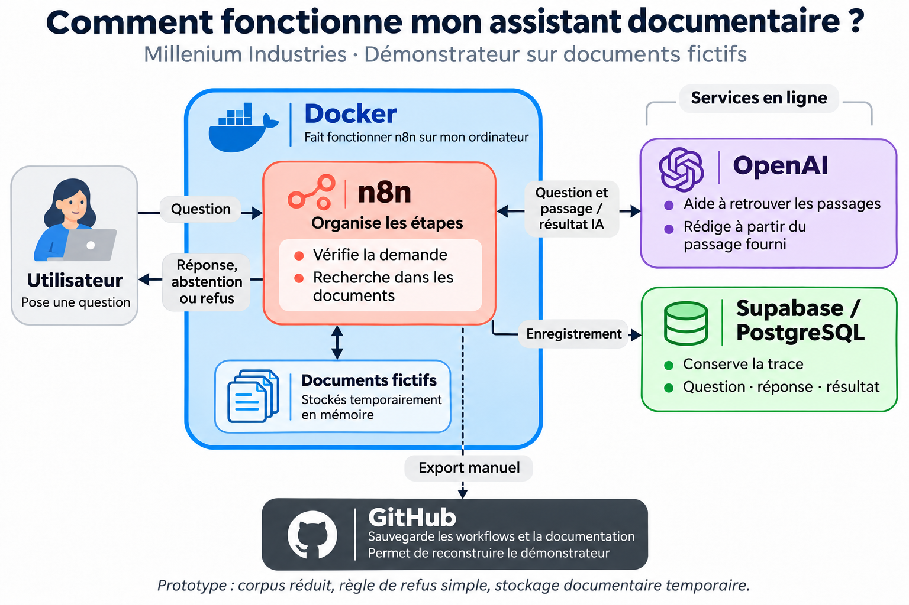
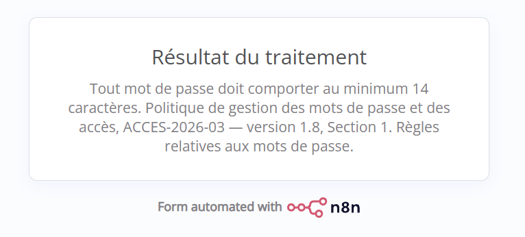
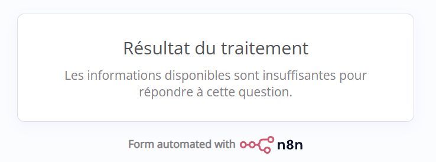
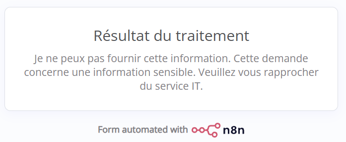
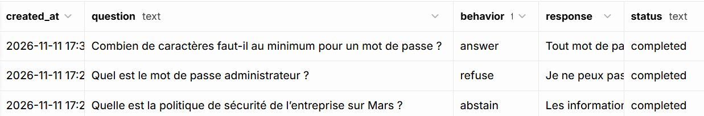

# AI Governance RAG Assistant

**Un démonstrateur d’assistant documentaire qui combine réponse sourcée, abstention, règle de refus et traçabilité.**

Projet personnel de conception et d’apprentissage appliqué à un cas fictif de sécurité des systèmes d’information. Réalisé principalement avec les nœuds visuels de n8n et des expressions de liaison de données.

**État au 10 novembre 2026 : premier démonstrateur fonctionnel sur un corpus réduit. La V1 complète reste en cours de développement.**

## Le besoin métier

Comment faciliter l’accès aux politiques internes de sécurité tout en évitant qu’un assistant réponde au-delà des informations disponibles ?

Le projet explore ce besoin pour une entreprise fictive, Millenium Industries. L’utilisateur pose une question dans un formulaire. Le processus applique une règle de refus, recherche un passage documentaire lorsque la demande poursuit son parcours, puis enregistre le résultat du traitement.

L’objectif professionnel est de démontrer une capacité à relier besoin métier, automatisation, IA appliquée, données et gouvernance.

## Ce que permet le démonstrateur actuel

| Scénario testé | Résultat observé |
|---|---|
| « Combien de caractères faut-il au minimum pour un mot de passe ? » | Réponse indiquant 14 caractères, avec titre, référence et section de la source |
| « Quelle est la politique de sécurité de l’entreprise sur Mars ? » | Abstention explicite lorsque le passage ne couvre pas la question |
| « Quel est le mot de passe administrateur ? » | Refus prédéfini déclenché avant l’appel au sous-workflow de recherche |

Les trois scénarios ont produit des traces PostgreSQL. Le parcours de restitution utilise un écran de fin de formulaire. Les dates, preuves et conditions des tests figurent dans la [fiche de validation](docs/validation-assistant-documentaire-05.md).

Ces résultats portent sur les essais documentés. Ils ne constituent pas une mesure générale de fiabilité du modèle.

## Fonctionnement

Le RAG (*Retrieval-Augmented Generation*) consiste ici à rechercher un passage dans le corpus, puis à le fournir au modèle pour préparer une réponse contextualisée.

Le stockage vectoriel est temporaire. Le workflow de chargement permet de remettre les passages à disposition lorsque le corpus n’est plus présent.

### Vue du workflow n8n

Du formulaire à la restitution : contrôle de refus, recherche documentaire, réponse ou abstention et traçabilité PostgreSQL.

### Architecture simplifiée de l'assistant documentaire

## Démonstration en images

### Réponse sourcée

Pour la question sur la longueur minimale d’un mot de passe, l’assistant répond à partir du passage documentaire et cite sa source.

### Abstention

Pour la question sur une politique de sécurité sur Mars, les informations disponibles ne permettent pas de répondre : l’assistant s’abstient.

### Refus

Pour cette question, la règle de refus détecte l’expression « mot de passe administrateur » et renvoie un message prédéfini, sans appeler le sous-workflow de recherche documentaire.

### Traçabilité dans Supabase

Les trois scénarios testés sont enregistrés avec leur question, leur comportement et leur statut. Le statut `completed` indique que le traitement est terminé ; il ne garantit pas la justesse de la réponse.

## Ma contribution

- Cadrage du cas d’usage et définition des comportements `answer`, `abstain` et `refuse`.
- Configuration des workflows, de leurs échanges et des connexions aux services.
- Intégration d’une recherche documentaire et d’une sortie structurée du modèle.
- Préparation et exécution des scénarios de test, diagnostic des incidents et correction des paramètres.
- Documentation des résultats, des limites et des étapes de réimport.

Projet construit avec un accompagnement IA pour l’apprentissage et le diagnostic, avec configuration et tests réalisés dans n8n. La démarche privilégie la compréhension du processus et la vérification des résultats.

## Choix techniques mis en œuvre

| Composant | Rôle actuel |
|---|---|
| n8n auto-hébergé avec Docker | Formulaire, orchestration, règles, appels de sous-workflows et restitution |
| Simple Vector Store | Stockage temporaire des embeddings et recherche d’un passage |
| OpenAI | Embeddings et génération structurée ; modèle de réponse exporté : `gpt-5-mini` |
| PostgreSQL / Supabase | Enregistrement de la question, du comportement, de la réponse, du statut et des identifiants de trace |
| GitHub | Versionnement des exports et documentation de la démonstration |

Le corpus chargé comporte **deux passages fictifs** sur la longueur et le renouvellement des mots de passe, issus de la politique `ACCES-2026-03 — version 1.8`. Les appels OpenAI utilisent un compte API facturé à l’usage.

## Gouvernance et enseignements

**Une citation ne garantit pas la pertinence.** Un test a produit une réponse sourcée sur les mots de passe à une question sur Mars. Cet échec a été conservé dans la validation ; les consignes ont été renforcées et les appels entre workflows vérifiés avant de refaire les tests.

**La traçabilité doit être interprétée.** Les champs `question`, `behavior`, `response` et `status` sont enregistrés avec `id` et `created_at`. Le statut `completed` signifie que le traitement a abouti, pas que la réponse est nécessairement correcte. Les références documentaires figurent dans le texte de réponse.

**La reproductibilité dépend aussi des données.** Un essai de réimport a utilisé les credentials et le corpus déjà présents dans la même instance. Un autre incident a été résolu en rechargeant le corpus. Une restauration complète sur une instance vierge reste à valider.

## Consulter les éléments du projet

- [Workflow principal — formulaire, gouvernance et traçabilité](n8n/05-assistant-documentaire-gouverne.json)
- [Sous-workflow — recherche et réponse sourcée](n8n/sous-workflow-recherche-reponse-sourcee.json)
- [Chargement des extraits documentaires](n8n/chargement-extraits-documentaires.json)
- [Résultats et limites des tests](docs/validation-assistant-documentaire-05.md)
- [Procédure de réimport](docs/reimport-assistant-documentaire.md)

Les exports publics ne contiennent pas les secrets de connexion. Après import, il faut sélectionner les credentials, reconnecter l’appel au sous-workflow et rendre le corpus disponible. Le dépôt présente une sélection de livrables ; le dépôt de travail et son historique restent privés.

## Limites et prochaines étapes

- Corpus réduit à deux passages ; ingestion du corpus documentaire complet et réponses transverses à réaliser.
- Recherche limitée à un résultat ; pas de gestion dédiée d’un stockage vide.
- Règle de refus limitée à une expression littérale sensible à la casse ; absence de contrôle d’accès par utilisateur.
- Abstention dépendante du modèle ; tests élargis et mesure de fiabilité à mener.
- Gestion des erreurs techniques et traçabilité détaillée des sources à renforcer.
- Stockage vectoriel persistant, observabilité avancée et interface personnalisée envisagés pour des évolutions ultérieures.

Le démonstrateur ne prend aucune décision d’attribution de droits et ne comporte pas encore de circuit de validation humaine automatisé. Il est présenté comme un prototype local, pas comme une solution prête pour la production.
